

<kbd>&nbsp;中文版&nbsp;</kbd>&nbsp;点击展开

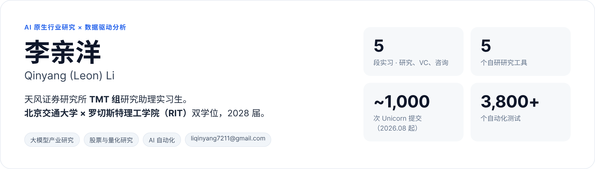

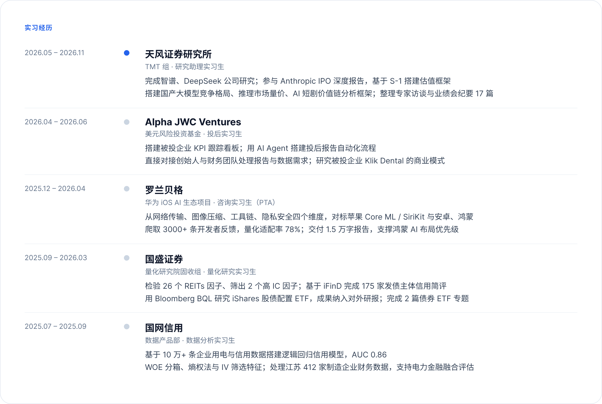

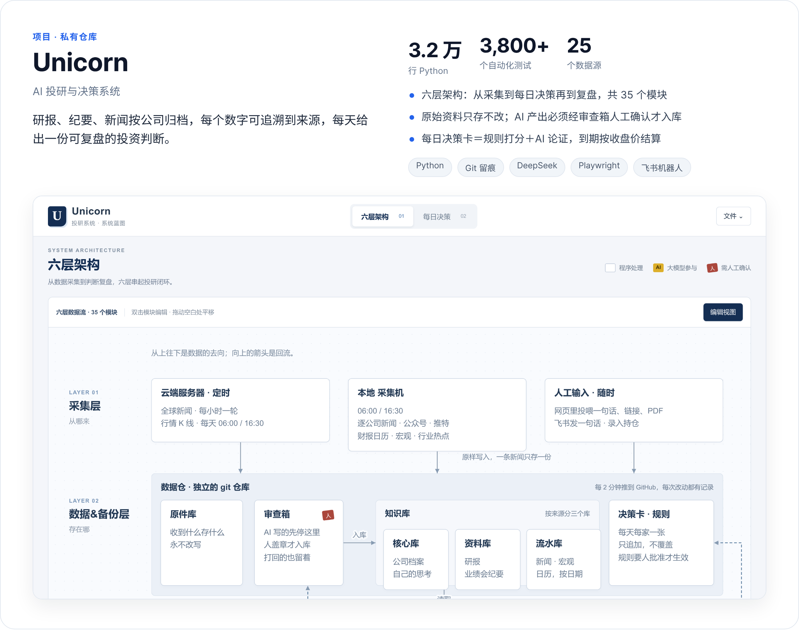

<a href="https://github.com/Leon-S-7211/Leon-S-7211/tree/main/n8n%E8%87%AA%E5%8A%A8%E6%90%9C%E5%AF%BB%E5%88%9D%E5%88%9B%E5%85%AC%E5%8F%B8%E6%96%B0%E9%97%BB">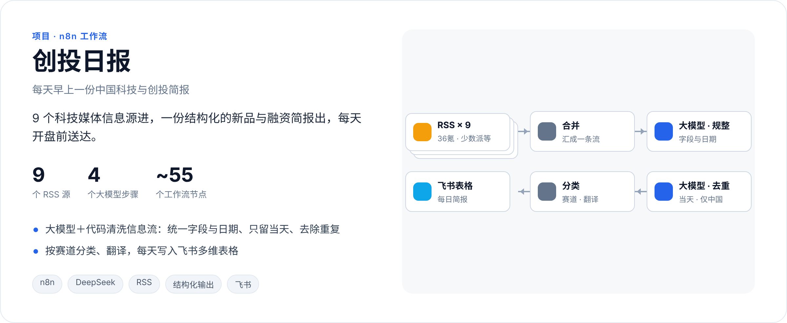</a>

<a href="https://github.com/Leon-S-7211/Douyin-to-text">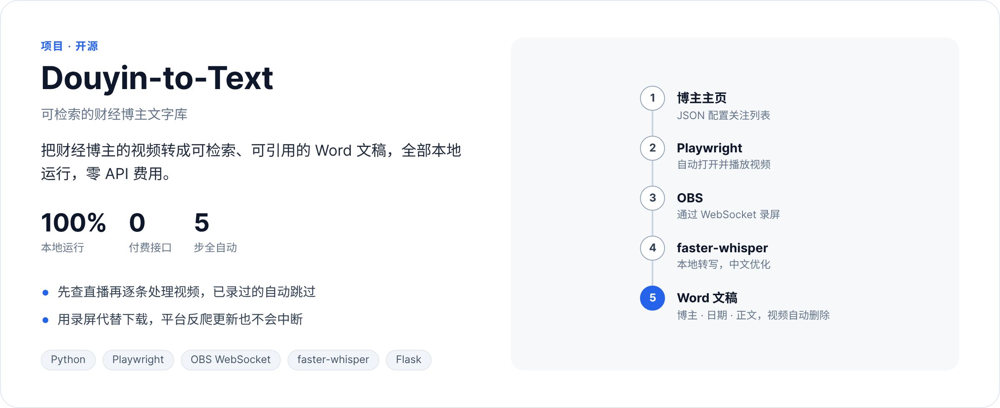</a>

<a href="https://github.com/Leon-S-7211/calendar-assistant">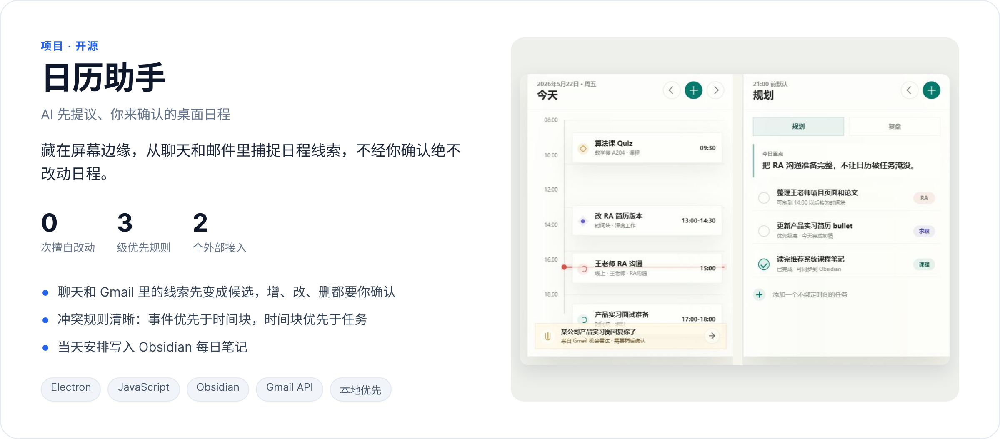</a>

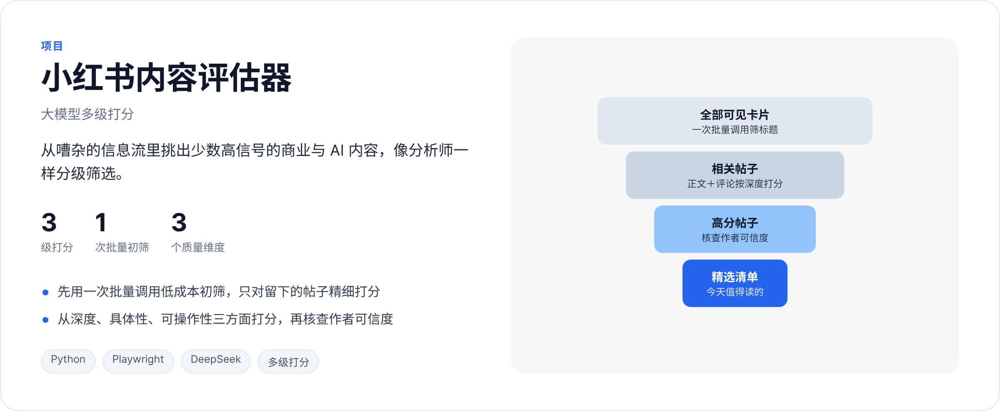

<b>工具</b> Python · SQL · Bloomberg（BQL）· iFinD · Playwright · n8n · Claude Code · Codex &nbsp;|&nbsp; <b>校园</b> Trae / Way To AGI 校园大使 · RIT 学生董事会联合副主席

<kbd>&nbsp;English&nbsp;</kbd>

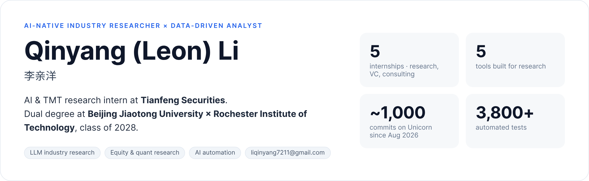

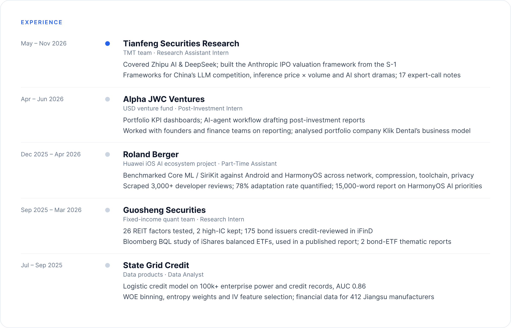

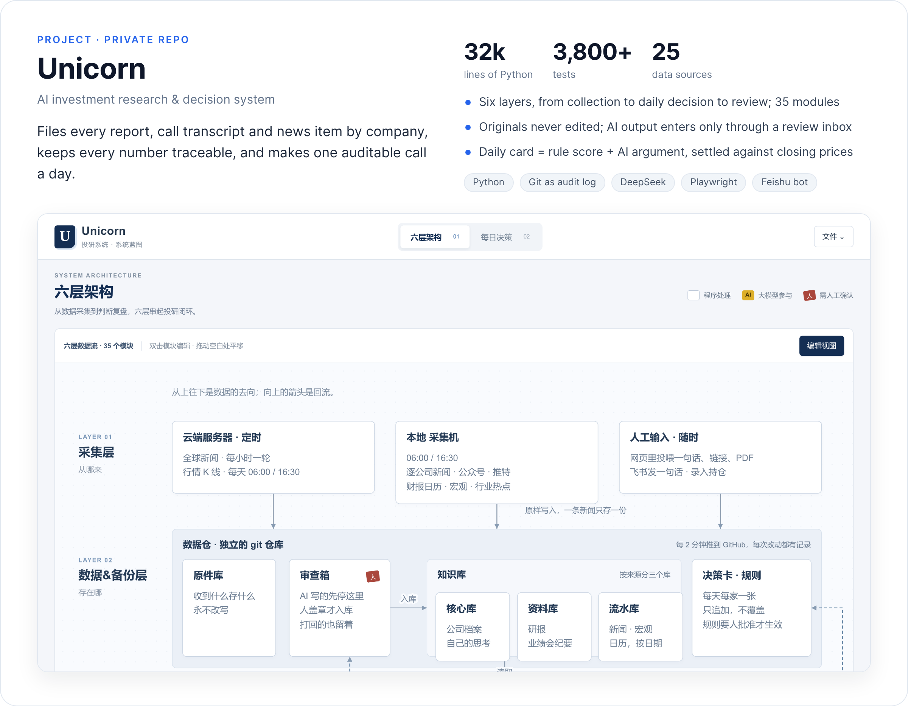

<a href="https://github.com/Leon-S-7211/Leon-S-7211/tree/main/n8n%E8%87%AA%E5%8A%A8%E6%90%9C%E5%AF%BB%E5%88%9D%E5%88%9B%E5%85%AC%E5%8F%B8%E6%96%B0%E9%97%BB">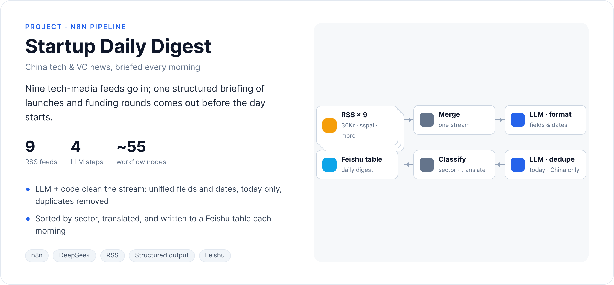</a>

<a href="https://github.com/Leon-S-7211/Douyin-to-text">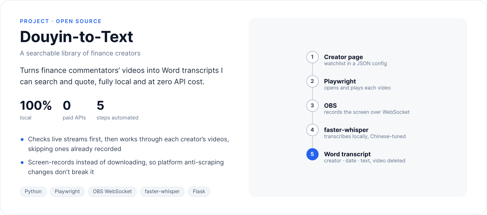</a>

<a href="https://github.com/Leon-S-7211/calendar-assistant">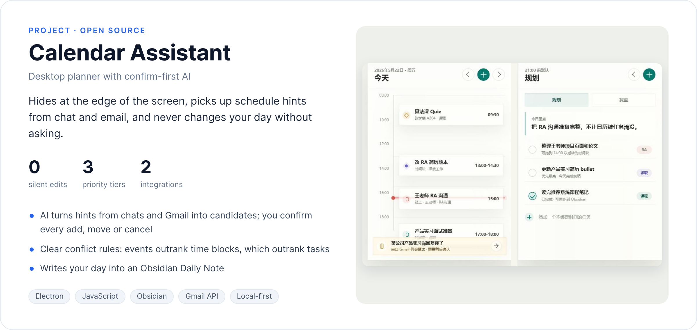</a>

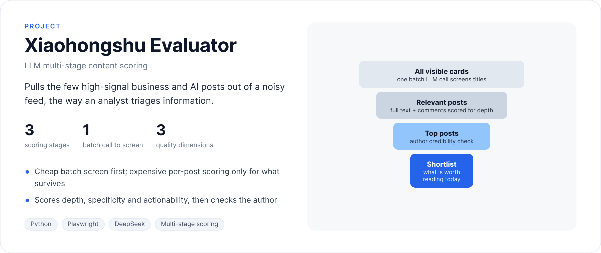

<b>Toolkit</b> Python · SQL · Bloomberg (BQL) · iFinD · Playwright · n8n · Claude Code · Codex &nbsp;|&nbsp; <b>Activities</b> Trae / Way to AGI Campus Ambassador · Co-Vice Chair, RIT Student Board

